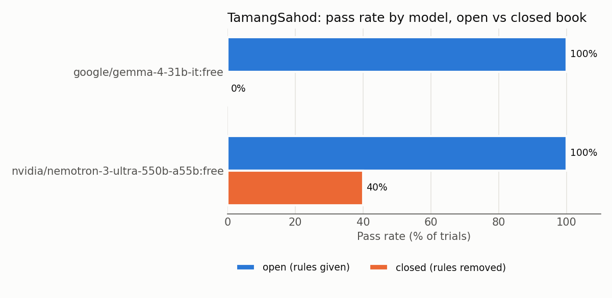

# TamangSahod

A small, reproducible eval of where frontier AI models fail at **Philippine payroll
and labor-compliance computations**. It covers premium pay, holiday pay (including coverage
exemptions and eligibility), overtime, night shift differential, weekly payroll, and
separation pay.

---

## What the eval tests

Each task gives the model a realistic payroll scenario. It runs in two conditions:

- **Open book:** the exact rules it needs are in the prompt, quoted from the DOLE-BWC
  *Handbook on Workers' Statutory Monetary Benefits*. This tests multi-step reasoning over
  the rules.
- **Closed book:** the same prompt with the rules removed. This tests whether the model
  actually knows Philippine labor law, which is how people really use AI assistants.

The tasks combine rules that interact, for example:
- stacking multipliers;
- excluding unpaid breaks;
- spotting which hours are overtime and which are night hours;
- applying one exemption but not another;
- deciding holiday-pay eligibility;
- rounding years of service.

## Why it matters

Holiday, overtime and night-shift premiums, and separation pay, are where Philippine payroll
most often goes wrong. The rules stack: a regular holiday on a rest day, with overtime, at
night, is 200% x 130% x 130% x 110%. Exemptions depend on the size and type of the business.
Holiday pay depends on attendance the day before. Small businesses and HR staff increasingly
ask AI assistants to compute or check these amounts. A confident wrong answer means a worker
is underpaid, or an employer owes back pay. This eval measures whether models apply the rules
correctly when they are given them, with answers checked against a deterministic calculator.

## Who it's for

- Teams building HR, payroll, or compliance assistants for the Philippine market
- Model developers checking multi-step numeric reasoning under jurisdiction-specific rules
- HR practitioners and small-business owners deciding how far to trust an AI payroll answer

## Tasks

**The full list is in [results/tasks_table.md](results/tasks_table.md)** (id, title,
difficulty, tags, verified). `python report.py` regenerates it.

Each task lives in `tasks/<id>/`:

| Field in `task.json` | Meaning |
|---|---|
| `prompt` | Full text sent to the model: rules + scenario + required answer format |
| `expected_answer` | Correct amount in pesos. It is generated by running `reference/calculator.py` on `reference_inputs`, never typed by hand |
| `tolerance` | Allowed difference (default ₱0.01) |
| `verified` | `true` only after every rule in the task was checked against the DOLE-BWC Handbook (see below) |
| `difficulty`, `tags` | Used for the breakdowns in the report |
| `failure_categories` | Mistakes the task is designed to catch |
| `source_refs` | Where each rule comes from in the DOLE-BWC Handbook |
| `reference_inputs` | Inputs for `reference/calculator.py`, used by the oracle check |

Every task also has a `solution.md`. It shows the step-by-step reference computation and
2–3 common wrong answers, each produced by re-running the calculator with one mistake.

Every prompt ends with a fixed line format:

```
FINAL ANSWER: ₱<amount with 2 decimals>
```

### Verification gate

A task is a **draft** until its rules are checked against the Handbook.

| | Draft (`"verified": false`) | Verified (`"verified": true`) |
|---|---|---|
| `run_eval.py` | skipped unless `--include-drafts` | runs |
| `report.py` | left out unless `--include-drafts`; then marked **DRAFT** in every table and the chart title | reported |
| `make_sample.py` | not copied unless `--include-drafts` | copied |
| `oracle_check.py` | answers still checked | also fails if `source_refs` is empty or still contains `TODO` |

## Grading method

`grader.py` is deterministic. It does not use an LLM judge.

1. It reads only the **last** `FINAL ANSWER:` line. Numbers in the working are ignored.
2. That line must hold exactly **one** amount.
   - Accepted forms: `₱`, `PHP`, `Php`, `P` or `P.` before the number, or `PHP`/`pesos`
     after it; valid thousands commas; 0–2 decimals.
   - Light formatting is removed first: markdown such as `**bold**`, and LaTeX such as
     `\boxed{}`, `\text{}` and `{,}`.
   - One trailing label in parentheses with no digits is allowed, e.g. `(total pay)`.
3. The result is `pass` if |answer − expected| ≤ tolerance, and `fail` otherwise.
4. If there's no parsable final line, the result is `format_failure`, with a
   `format_reason`: `no_final_line`, `empty_answer`, `multiple_amounts`,
   `malformed_number` or `extra_text`. These are reported separately from wrong answers.
5. Comparisons use `Decimal`, not float, so an answer exactly at the tolerance edge is
   never falsely failed.

**Grader reliability:**
- `tests/test_grader.py` has 86 test cases of tricky outputs, including:
  - multiple numbers, commas, `PHP 2258.9`;
  - a missing line, or a corrected answer;
  - European formatting, LaTeX, and labels.
- `oracle_check.py` proves every task is solvable and graded correctly. For each task:
  - the expected answer passes the grader;
  - an independent reference calculator reproduces the expected answer;
  - a wrong answer fails;
  - verified tasks have real `source_refs`.

API errors are retried with exponential backoff, and Retry-After is respected. They are
**never counted as model failures**:
- HTTP 408/429/5xx, and an HTTP 200 whose body contains an error, are retried.
- HTTP 400/401/402/404 are fatal and skip the rest of that model.
- Errors are logged to `results/api_errors.jsonl`, which is git-ignored.

## How to run

Tested with Python 3.14.2 on Windows 11. Python 3.11 or newer is required.

```bash
git clone https://github.com/pork-arie/TamangSahod.git && cd TamangSahod
python -m venv .venv
# Windows: .venv\Scripts\activate    macOS/Linux: source .venv/bin/activate
pip install -r requirements.txt

cp .env.example .env              # then paste your OpenRouter key into .env (Windows: copy)

python -m pytest                  # grader, calculator, pipeline tests (no API key needed)
python oracle_check.py            # every task solvable & graded correctly (no API key needed)

python run_eval.py                # verified tasks x models x trials from config.yaml
python report.py                  # writes results/summary.md, pass_rate.png, tasks_table.md
```

The API key is read from `.env` only. It is never printed, logged, or saved in results.

### Options

| Command | What it does |
|---|---|
| `python run_eval.py --models <id>,<id>` | override the models in `config.yaml` (OpenRouter ids) |
| `python run_eval.py --tasks task_01,task_02` | run only these tasks (default `all`) |
| `python run_eval.py --trials 3` | trials per task per model (default from `config.yaml`) |
| `python run_eval.py --max-cost-usd 2.00` | stop starting new trials once this run's reported cost reaches $2.00 |
| `python run_eval.py --include-drafts` | also run draft tasks |
| `python report.py --include-drafts` | also report draft tasks, marked DRAFT |
| `python run_eval.py --condition closed` | closed-book run: the same prompts with the RULES section removed (default `open`) |
| `python report.py --condition open\|closed` | report one condition only (default: both, side by side) |
| `python regrade.py [--dry-run]` | re-grade saved trials with the current grader and answer key; no API calls |

**Settings** in `config.yaml`:
- `temperature`, `max_tokens`, `trials_per_task`, and retry/backoff settings;
- `max_tokens_overrides`, which gives a per-model output budget. Reasoning models need more
  tokens or their answers get cut off.

### Resume, stale results, and regrading

- Each finished trial is saved to `results/raw/<model>/<condition>/<task>/trial_<n>.json`, and the next
  run skips it. An interrupted run (Ctrl+C, rate limits) continues where it stopped.
- Each trial records:
  - `prompt` and `prompt_sha256`, `settings` (temperature, max_tokens), `expected_answer`;
  - full `response`, `reasoning`, `finish_reason`, extracted answer, `status` and `format_reason`;
  - latency, token usage, cost, and the exact model and provider OpenRouter served;
  - a timestamp.
- If a task's prompt changes, its old trials no longer match `prompt_sha256`.
  - `run_eval.py` moves them to `results/stale/` (kept, not deleted) and re-runs them.
  - `report.py` ignores them.
- If `grader.py` or an `expected_answer` changes, run `python regrade.py`. It re-grades
  saved trials in place and keeps the old grade under `previous_grade`.
- `report.py` warns if one model's trials were run with mixed settings (e.g. different
  `max_tokens`).

### Report metrics

| Metric | Meaning |
|---|---|
| Pass rate | passed trials / all trials |
| pass^k | share of tasks where **all** k trials passed (consistency, not luck) |
| Format failures | trials with no parsable `FINAL ANSWER` line |
| Truncated | trials cut off by `max_tokens` (`finish_reason == "length"`); counted inside format failures |

There are also per-task, by-difficulty and by-tag tables, plus a bar chart.

**Expected runtime and cost** (from the saved trials):
- `pytest` and `oracle_check.py` take a few seconds and need no API key.
- A full run is 10 tasks × 3 trials = 30 calls per model per condition.
  - Nemotron, open book: about 35 minutes of model time (about 69 s per trial; median
    3,852 completion tokens).
  - Nemotron, closed book: about 50 minutes (about 99 s per trial; median 7,998
    completion tokens). Without the rules it reasons about twice as long.
  - Gemma: about 15 s per trial (about 470 completion tokens).
- Both models are OpenRouter **free** variants, so the cost was **$0.00**.
- Free models are rate-limited (HTTP 429). Expect waits, and re-run the same command to
  fill in gaps: finished trials are skipped.

**Models and settings used for the reported results** (runs from Oct 31 to Nov 8, 2026):

| Model (OpenRouter id) | temperature | max_tokens | trials per task |
|---|---|---|---|
| `nvidia/nemotron-3-ultra-550b-a55b:free` | 0.0 | 16384 (per-model override; it is a reasoning model) | 3 |
| `google/gemma-4-31b-it:free` | 0.0 | 4096 | 3 (some missing, see Limitations) |

### Open-book vs closed-book condition

Every task can run in two conditions:

| Condition | Prompt sent | Tests |
|---|---|---|
| `open` (default) | the task prompt as written: rules + scenario + question | applying given rules |
| `closed` | the **same** prompt with the `RULES (...)` section removed; the intro, scenario, question and `FINAL ANSWER` line are unchanged | knowing Philippine labor rules unaided |

- The expected answers, grader and calculator are the same for both conditions.
- `tasks/__init__.py` builds the closed prompt by cutting from `RULES (` up to `SCENARIO:`.
- **Fairness:** the closed prompt removes general law only.
  - Task-specific facts and conventions that are **not** law are put back under a
    `GIVEN FACTS:` heading, listed in task.json `closed_book_keep`. Examples: the employer's
    days factor, "the company has no policy or CBA", a rounding method, "no other pay
    components".
  - Wording that points at the missing rules (e.g. "a rule above") is rewritten for the
    closed prompt only, via task.json `closed_book_replace`. Open prompts, and their hashes,
    never change.
- `oracle_check.py` (check 5) verifies every closed prompt: no rules left, no "above",
  every kept fact present, and the scenario, question and `FINAL ANSWER` line intact.
- Each trial records its `condition`, and its `prompt_sha256` is the hash of the prompt
  actually sent, so the two conditions resume and go stale independently.
- `report.py` shows them side by side: an "Open vs closed book" table, one column per model
  per condition in the per-task, difficulty and tag tables, and paired bars in the chart.

## Results

Full tables: [results/summary.md](results/summary.md). Verified tasks only.

**Nemotron 3 Ultra** (the complete run: 10 tasks × 3 trials × 2 conditions):

| Condition | Pass rate | pass^k | Format failures (truncated) |
|---|---|---|---|
| Open book (rules given) | **100%** (30/30) | 100% (10/10 tasks) | 0% |
| Closed book (rules removed) | **40%** (12/30) | 30% (3/10 tasks) | 7% (2 trials) |

Per task, closed book: task_04, 06 and 08 passed 3/3; task_07 2/3; task_01 1/3; task_02,
03, 05, 09 and 10 passed 0/3.

**Headline finding:** the model can *apply* Philippine payroll rules perfectly when it is
given them, but it does not *know* them.
- With the rules in the prompt, it made zero errors, including on a 14-day timesheet and on
  exemption cut-offs at exactly 5, 9 and 10 workers.
- With the same scenarios and no rules, its pass rate fell from **100% to 40%**.
- The failures are not random. **15 of its 18 closed-book failures involve the night shift
  differential.** On the 6 tasks with night hours it passed **1 of 18** trials. On the 4
  tasks without night hours it passed **11 of 12**.

**Gemma 4 31B:**
- Open book: 100% (16/16 trials; the free tier's rate limits left gaps).
- Closed book: cut short by the same rate limits. Its few closed trials are in
  [results/summary.md](results/summary.md); they are too few to draw conclusions from.



Full transcripts of the reported trials are in [results/sample/](results/sample/).

## Failure analysis

All 18 of Nemotron's closed-book failures, each classified by reading its transcript
(`results/sample/nvidia__nemotron-3-ultra-550b-a55b_free/closed/`).
- In every one of the 15 night-differential failures, that is the **only** mistake: the rest
  of the computation (day premium, overtime factor, meal break, exemptions) is correct. Each
  wrong amount equals the calculator's result with just that one change.
- Four of the wrong amounts (₱2,220.80, ₱705.31, ₱4,981.01, ₱13,700.00) appear in advance in
  the tasks' `solution.md` files. For ₱705.31 the predicted cause was "applies both
  exemptions"; the transcripts show the actual cause is simpler: the night differential is
  never considered at all.

| Mistake (as seen in the transcript) | Trials | Tasks (wrong answer) |
|---|---|---|
| **Night differential on the basic rate.** The transcript states it explicitly, e.g. "10% of basic hourly rate", "10% × ₱80", "10% × HR = ₱9.00", and adds that flat amount instead of multiplying the holiday / rest-day / overtime rate by 1.10 | **9** | task_01 ×2 (₱2,220.80), task_02 ×2 (₱1,765.81), task_03 (₱720.56), task_05 (₱4,989.07), task_09 ×3 (₱10,175.40) |
| **Night differential never mentioned.** The answer computes the day correctly but does not mention night work or a differential at all | **6** | task_03 ×2 (₱705.31), task_05 (₱4,981.01), task_10 ×3 (₱2,852.44) |
| Ran out of output budget (no final answer) | 2 | task_02, task_05 (all 16,384 tokens used) |
| Skipped the one-month minimum for separation pay | 1 | task_07 (₱13,700.00) |

**1. The night shift differential is the blind spot (15 of 18 failures).**
- The Handbook says the 10% is computed on "the corresponding hourly rate" (Ch. 5 C, p. 26),
  and its rate table multiplies it in, e.g. special day + night + overtime =
  1.3 × 1.1 × 1.3 = 1.859 (pp. 2–3).
- In 9 trials the model says it uses the basic rate; in 6 it ignores night work. In task_02 it writes: *"NSD of 10% of regular
  hourly rate per hour (Art. 86, Labor Code)"*. It cites the right article and still
  computes 2 × 0.10 × ₱143.68 = ₱28.74, getting ₱1,765.81 instead of ₱1,780.04. Every other
  step of that answer is correct.
- In task_10 (all 3 trials) it applies the holiday-pay exemptions correctly (fewer than 10
  workers) and the holiday overtime rate correctly, but never mentions the night differential
  for anyone. The transcripts do not say why, so we do not guess.
- The same wrong rule appears in the same way across trials and across tasks, so this is a
  stable gap in what the model believes the law is, not noise.
- Each wrong answer is short by only about ₱2–₱54, which is exactly how payroll underpayment
  goes unnoticed.

**2. What it does know.** Without any rules it still got these right:
- unworked-holiday eligibility through a rest day (task_04, 3/3);
- separation-pay formulas and the 6-month fraction rule (task_06 and 08, 6/6);
- premiums on rest days, special days and holidays, overtime factors, excluding the meal
  break, and the holiday-pay exemption threshold.

The knowledge gap is narrow and specific.

**3. Output budget.**
- With the original `max_tokens = 4096`, Nemotron produced no final answer in 3 of 3
  open-book trials on task_01. The budget was then raised to 16,384.
- Closed book, it still hit 16,384 twice: without rules it reasons about twice as long
  (median 7,998 vs 3,852 tokens).
- A reasoning model can fail silently on exactly the long cases, unless the output budget is
  sized for them. The report shows this in the **Truncated** column. The old 4096-token
  trials are in `results/archive_max_tokens_4096/` (git-ignored).

**What this means for payroll tools:** do not rely on a model's built-in knowledge of
Philippine labor rules. Given the rules, it computed correctly every time. Without them it
underpaid night work in 15 of 18 failures. A payroll assistant should put the applicable
rules in the prompt, or retrieve them, and should be tested on night-shift cases in
particular.

## Limitations

- **10 tasks, 2 free models.** The results are indicative, not a benchmark. Frontier paid
  models were not run; `config.yaml` has a placeholder to add them, and `--max-cost-usd`
  caps the spend.
- **Gemma coverage is incomplete.** The free tier's rate limits (HTTP 429) prevented 14 of its
  30 trials, including all of task_02, task_09 and task_10. API errors are never counted
  as model failures; missing trials are simply absent, and the report shows k per task.
- **Gemma's closed-book run is too incomplete to compare** (free-tier rate limits). The
  open-vs-closed finding rests on Nemotron's complete 60-trial run.
- **The open condition shows no failures** for either model, so it cannot rank models on
  accuracy. The closed condition is where models differ.
- **Closed book keeps a few given facts** (a days factor, "no policy or CBA", rounding
  conventions, "no other pay components"). These are task facts, not law; see the Fairness
  note above.
- Private-sector rules only. The calculator raises `NotImplementedError` instead of guessing
  for:
  - shifts that cross midnight;
  - an exempt employee working a holiday that is also a rest day, or a special day;
  - an unworked holiday that is also a rest day, and unworked double holidays;
  - two or more rest or non-working days before an unworked holiday;
  - 13th month pay and retirement pay.

  See the `SOURCE:` and `NOTE:` comments in `reference/calculator.py`.
- **Simplifications kept on purpose:**
  - The Handbook excludes managerial employees and field personnel from overtime and night
    differential too; the calculator applies only the holiday-pay exclusion to them, and no
    task uses them.
  - The separation-pay base is "the monthly rate given", because the Handbook includes
    regular allowances and the scenarios state there are none.
  - Rounding to centavos is a stated convention; the Handbook gives no rounding rule.
- Model outputs vary between runs, even at temperature 0. pass^k over k trials is reported
  to show consistency.
- OpenRouter may route a model id to different providers. The served model and provider are
  logged per trial.
- Not legal advice. Rules should be checked against the current DOLE-BWC Handbook.

## What existed before vs. built during the hackathon

| Before the hackathon | Built during the hackathon |
|---|---|
| Nothing. No code, tasks, notes or data existed before the event. | Everything in this repository (Oct 30 – Nov 9, 2026): the calculator, grader, harness, report, packaging scripts, all 10 tasks and solutions, the Handbook verification, all tests, and all results. |

## Building the submission ZIP

```bash
python make_sample.py        # copy final transcripts of verified tasks into results/sample/
git add . && git commit -m "Final results"
python make_submission.py    # builds submission.zip from the last commit
```

`make_submission.py` packs only committed, tracked files (`git archive HEAD`). It warns about
uncommitted changes. It **deletes the ZIP and stops** if the ZIP would contain any of:
- `.env`, `.git/`, `__pycache__/`, `.pytest_cache/`, `.venv/`, or `results/api_errors.jsonl`;
- any file with the OpenRouter key prefix `sk-` + `or-`;
- 50 MB or more in total.

It prints the file list and the size.

## Repository layout

```
config.yaml              models, trials, temperature, max_tokens (+ per-model overrides), retries
.env.example             copy to .env and add your OpenRouter key (.env is git-ignored)
tasks/<id>/task.json     prompt, expected answer, verified flag, tags, reference inputs, ...
tasks/<id>/solution.md   step-by-step reference computation + common wrong answers
tasks/__init__.py        loads and validates tasks; prompt hashing
reference/calculator.py  deterministic calculator (only the supplied rules; VERIFY comments)
grader.py                answer extraction -> pass / fail / format_failure
oracle_check.py          proves tasks are solvable and graded correctly; verification gate
run_eval.py              calls models via OpenRouter, saves every trial, resumes
regrade.py               re-grades saved trials with the current grader (no API calls)
report.py                tables, pass^k, breakdowns, chart, tasks table -> results/
make_sample.py           copies final transcripts into results/sample/
make_submission.py       builds and checks submission.zip
tests/                   pytest: grader, calculator, pipeline, verification gate, packaging
results/                 summary.md, pass_rate.png, tasks_table.md, sample/ (raw/ is git-ignored)
```
