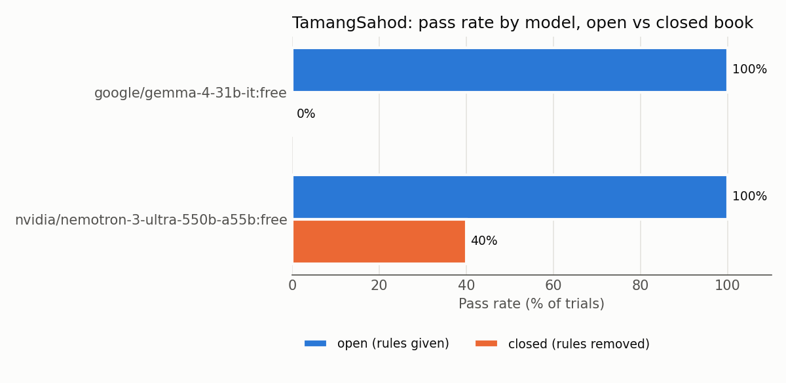

# Results

Conditions shown: **open (rules given)**, **closed (rules removed)**. The expected answers are the same in both.

## Open vs closed book

| Model | Open (rules given) | Closed (rules removed) | Difference |
|---|---|---|---|
| `google/gemma-4-31b-it:free` | 100% (16/16) | 0% (0/3) | -100 pp |
| `nvidia/nemotron-3-ultra-550b-a55b:free` | 100% (30/30) | 40% (12/30) | -60 pp |

_pp = percentage points (closed minus open)._

## Overall

| Model | Condition | Pass rate | pass^k | Format failures | Truncated | Trials |
|---|---|---|---|---|---|---|
| `google/gemma-4-31b-it:free` | open | 100% (16/16) | 100% (7/7 tasks, k=1/2/3) | 0% | 0% | 16 |
| `google/gemma-4-31b-it:free` | closed | 0% (0/3) | 0% (0/3 tasks, k=1) | 0% | 0% | 3 |
| `nvidia/nemotron-3-ultra-550b-a55b:free` | open | 100% (30/30) | 100% (10/10 tasks, k=3) | 0% | 0% | 30 |
| `nvidia/nemotron-3-ultra-550b-a55b:free` | closed | 40% (12/30) | 30% (3/10 tasks, k=3) | 7% | 7% | 30 |

_pass^k = share of tasks where every one of the k trials passed. Truncated = reply cut off by max_tokens (counted inside format failures)._

## Per task (passed / trials)

| Task | Difficulty | `google/gemma-4-31b-it:free` open | `google/gemma-4-31b-it:free` closed | `nvidia/nemotron-3-ultra-550b-a55b:free` open | `nvidia/nemotron-3-ultra-550b-a55b:free` closed |
|---|---|---|---|---|---|
| task_01 | medium | 3/3 | 0/1 | 3/3 | 1/3 |
| task_02 | medium | – | 0/1 | 3/3 | 0/3 |
| task_03 | hard | 2/2 | 0/1 | 3/3 | 0/3 |
| task_04 | hard | 3/3 | – | 3/3 | 3/3 |
| task_05 | hard | 2/2 | – | 3/3 | 0/3 |
| task_06 | medium | 1/1 | – | 3/3 | 3/3 |
| task_07 | hard | 2/2 | – | 3/3 | 2/3 |
| task_08 | hard | 3/3 | – | 3/3 | 3/3 |
| task_09 | hard | – | – | 3/3 | 0/3 |
| task_10 | hard | – | – | 3/3 | 0/3 |

## By difficulty

| Difficulty | tasks | `google/gemma-4-31b-it:free` open | `google/gemma-4-31b-it:free` closed | `nvidia/nemotron-3-ultra-550b-a55b:free` open | `nvidia/nemotron-3-ultra-550b-a55b:free` closed |
|---|---|---|---|---|---|
| hard | 7 | 100% | 0% | 100% | 38% |
| medium | 3 | 100% | 0% | 100% | 44% |

## By tag

_A task with several tags counts in each tag's row._

| Tag | tasks | `google/gemma-4-31b-it:free` open | `google/gemma-4-31b-it:free` closed | `nvidia/nemotron-3-ultra-550b-a55b:free` open | `nvidia/nemotron-3-ultra-550b-a55b:free` closed |
|---|---|---|---|---|---|
| absence | 2 | 100% | – | 100% | 50% |
| days_factor | 1 | – | 0% | 100% | 0% |
| exemption_thresholds | 1 | – | – | 100% | 0% |
| holiday_pay_eligibility | 2 | 100% | – | 100% | 50% |
| holiday_pay_exemption | 2 | 100% | 0% | 100% | 0% |
| meal_break | 6 | 100% | 0% | 100% | 6% |
| minimum_separation_pay | 1 | 100% | – | 100% | 67% |
| monthly_paid | 1 | – | 0% | 100% | 0% |
| multi_week_payroll | 1 | – | – | 100% | 0% |
| multiple_employees | 1 | – | – | 100% | 0% |
| night_shift | 6 | 100% | 0% | 100% | 6% |
| nsd_exemption | 2 | 100% | 0% | 100% | 0% |
| overtime | 6 | 100% | 0% | 100% | 6% |
| redundancy | 1 | 100% | – | 100% | 100% |
| regular_holiday | 6 | 100% | 0% | 100% | 22% |
| rest_day | 4 | 100% | 0% | 100% | 33% |
| retrenchment | 2 | 100% | – | 100% | 83% |
| rounding | 2 | 100% | – | 100% | 0% |
| separation_pay | 3 | 100% | – | 100% | 89% |
| special_non_working_day | 3 | 100% | 0% | 100% | 0% |
| unworked_day | 1 | 100% | – | 100% | 0% |
| unworked_holiday | 2 | 100% | – | 100% | 50% |
| weekly_payroll | 1 | 100% | – | 100% | 0% |
| years_of_service_fraction | 3 | 100% | – | 100% | 89% |

